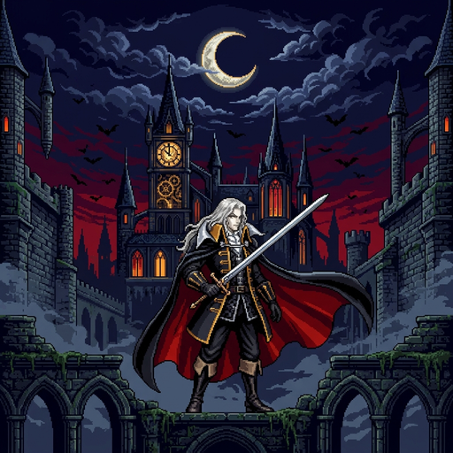
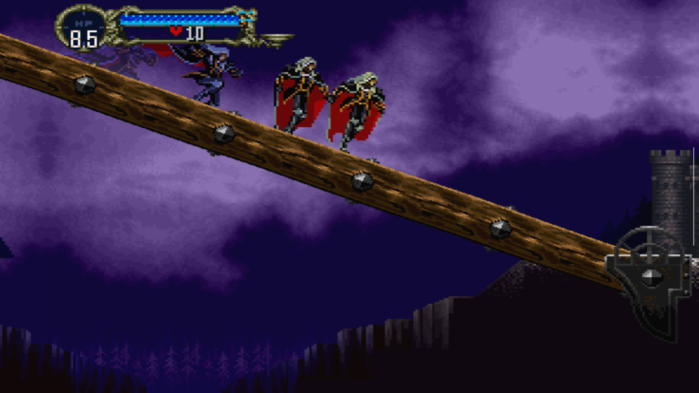
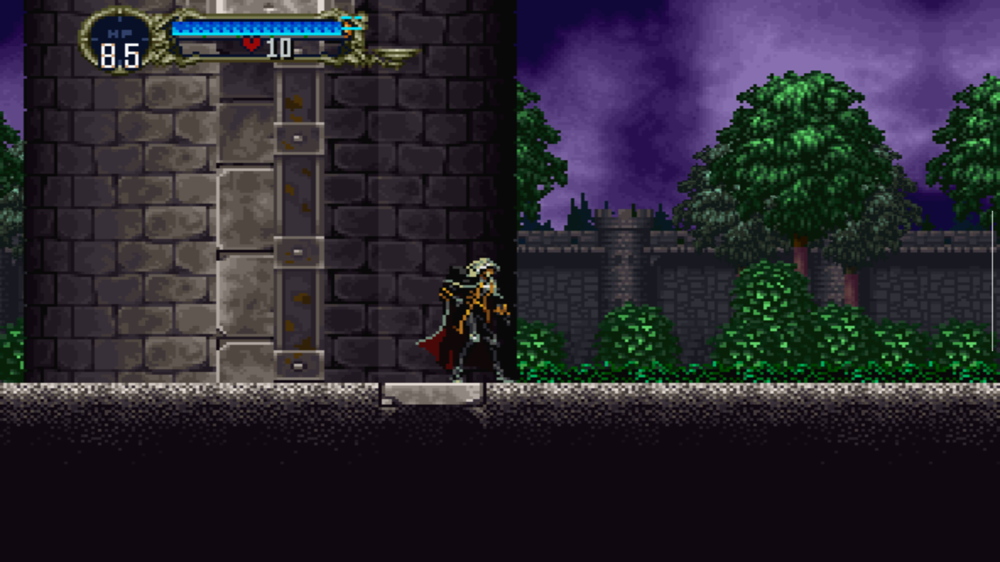

# 📱 SymphonyRecomp Ultimate — Community Android & Handheld Port

<p align="center">
  <a href="https://github.com/dmillerzx/SymphonyRecomp-Ultimate-Android/releases/latest">
    
  </a>
  <a href="https://github.com/dmillerzx/SymphonyRecomp-Ultimate-Android/releases">
    
  </a>
  
  
  <a href="https://github.com/dmillerzx/SymphonyRecomp-Ultimate-Android/issues">
    
  </a>
</p>

> [!NOTE]
> **Native Android-Only Fork**: This repository is a community-driven fork maintained by [dmillerzx](https://github.com/dmillerzx) (built with AI assistance and verified on real hardware) dedicated **exclusively to native Android (`arm64-v8a` / `x86_64`) handheld releases** of **Castlevania: Symphony of the Night (Ultimate v1.4)** — verified on the **Retroid Pocket 5** (Qualcomm Snapdragon 865, Adreno 650, Android 13).
>
> * **Android Releases Only**: We do **not** publish Windows, Linux, or macOS releases from this repository. Upstream desktop work lives at **BlackLabelHQ** and the upstream Android port lives at [sergiomanzur/SymphonyRecomp](https://github.com/sergiomanzur/SymphonyRecomp) / [sergiomanzur/RecompOne](https://github.com/sergiomanzur/RecompOne).
> * **SOTN Ultimate v1.4 Credit**: All Ultimate gameplay enhancements, Saturn content, PSP dub/script, and ROM hack patches belong to **[renanbianchi/sotn-ultimate](https://github.com/renanbianchi/sotn-ultimate)** (*Castlevania: SotN Ultimate*).
> * **Issue Reporting**: Please do **not** open issues for this fork on `BlackLabelHQ`, `sergiomanzur`, `renanbianchi/sotn-ultimate`, or the SOTN Decomp project. Report issues specific to this build on [dmillerzx/SymphonyRecomp-Ultimate-Android](https://github.com/dmillerzx/SymphonyRecomp-Ultimate-Android/issues).
> * **No Game Assets**: This repository and its releases contain **no game data**. You supply your own legally obtained **North American (USA) PlayStation release** (`Castlevania: Symphony of the Night (USA)`) `.bin`/`.cue` disc dump on first launch.

<p align="center">
  <br>
  <b>Native Android Handheld Port (arm64-v8a / OpenGL ES)</b><br>
  <i>Verified at 1080p 60 FPS on Retroid Pocket 5 (Snapdragon 865 / Adreno 650)</i>
</p>

| Castle Entrance Drawbridge (1080p 16:9 on RP5) | Castle Gatehouse (1080p 16:9 on RP5) |
| :---: | :---: |
|  |  |

---

### What Makes This Android Fork Different

| Feature | Android Handheld Implementation |
| :--- | :--- |
| **Ultimate v1.4 Static Recompilation** | Built against Ultimate v1.4 overlays (`main`, `dra`, `sel`, `st0`, `no3`, and stage overlays via `config_ultimate/` + `*Aliases.cs`) with verified hooks for `CamCol`, `SetNextRoomToLoad`, `RenderTilemap`, `InitFade`, `SetFadeWidth`, `SetFadeMode`, and `AllocPrimitives` |
| **QOL & Castle Entrance (`NO3`) Fixes** | Fixed `Skip Prologue` on Ultimate v1.4, gated `Tetra Spirit`/`Hellfire` behind `UseEasySpellInput`, fixed `DoGravityJump` early return, unhooked mis-mapped `RemoveFlashes` from `CreateHPNumMove`, and resolved the `NO3` stack-leak crash |
| **True 16:9 Widescreen & Edge Clamping** | Uses `WindowManager.MaximumWindowMetrics` / `Display.GetRealMetrics` for exact `1.778` (`1920x1080`) aspect detection, full `RenderTilemapWide` column expansion, and background edge clamping |
| **FMV & Double-Buffer Fix** | Clamps cross-buffer `offY` (`(dispY & 0xFF) - (src.Y & 0xFF)`) in `GlCore.PresentDisplay` to eliminate vertical-stripe artifacts during FMVs and menu transitions |
| **60 FPS Handheld Tuning** | Compiles Release with `PublishTrimmed=false` / `AndroidLinkMode=None`, removes per-flush `GlDiag` logcat spam and `glReadPixels` GPU stalls, defaults to `RenderScale = 2`, and widens `WaitVBlanks` sleep margin (`4.0ms`) |
| **Adaptive App Icon** | Full-bleed pixel-art adaptive launcher icon (`mipmap-anydpi-v26/icon.xml`) with zero white launcher border |
| **Vanilla USA Disc Support** | Primary input is a standard vanilla **North American (USA) PS1 `.bin`/`.cue`** dump (`SLUS_000.67`) — no pre-patched Ultimate ISO required (Ultimate v1.4 `.bin`/`.cue` is also accepted) |

---

### 🎮 Android Quick Start & Hardware Compatibility

1. **Download**: Grab `com.blacklabelhq.sotn-Signed.apk` from [GitHub Releases](https://github.com/dmillerzx/SymphonyRecomp-Ultimate-Android/releases/latest).
2. **Disc Import (In-App Picker)**: On first launch, use the in-app Android file picker to select your legally obtained **North American (USA)** `Castlevania: Symphony of the Night (USA)` `.cue` and `.bin` files from anywhere on internal storage or MicroSD. The app copies and indexes them into app-private storage once and never asks again.
3. **Recommended Handheld Settings**:
   - **Render scale**: `2x` (default for locked 60 FPS on Snapdragon 865 / Adreno 650; adjustable up to `4x` in the in-game Display menu).
   - **Aspect ratio**: `Auto (Device)` for full-screen `16:9` widescreen.
4. **Obtainium Auto-Updates**: Add `https://github.com/dmillerzx/SymphonyRecomp-Ultimate-Android` in Obtainium with APK filter `com\.blacklabelhq\.sotn-Signed\.apk$` to receive automatic updates.

---

## Features

- **Native Performance**: Statically recompiled PS1 MIPS to C#/.NET — no emulator and no BIOS file required.
- **Physical Controllers & Touch Controls**: Full handheld/Bluetooth/USB controller support with PlayStation / Xbox / Nintendo button layouts, plus a customizable PSX touch overlay (D-pad or virtual stick, opacity, and hide toggle).
- **Save States & Memory Cards**: 5 save-state slots plus `.mcr`/`.mcd`/`.sav` (and DexDrive/VGS) memory card import/export.
- **Quality of Life**: Skip Prologue, Easy Spell Inputs, Gravity Boots jump fix, Extra Invincibility Frames, Infinite Wing Smash, Colorblind palettes, and Anti-Freeze toggles.
- **Cheats, Stats & On-Device Mods**: Built-in item/relic/spell editor and on-device Roslyn C# mod compilation.

---

## Building from Source

Building from source requires a compatible **SOTN Ultimate v1.4** disc image for recompilation and the **.NET 10 Android workload (`net10.0-android`)**:

```powershell
git clone --recursive https://github.com/dmillerzx/SymphonyRecomp-Ultimate-Android.git
cd SymphonyRecomp-Ultimate-Android
dotnet clean RecompOne.SoTN.Android.csproj -c Release
dotnet build RecompOne.SoTN.Android.csproj -c Release
```

> **Note (`net10.0-android` Release)**: Always run `dotnet clean -c Release` before `dotnet build -c Release` so Android JNI typemaps stay in sync.

---

## Credits

- **Castlevania: SotN Ultimate v1.4**: **[renanbianchi/sotn-ultimate](https://github.com/renanbianchi/sotn-ultimate)** — Saturn areas, Saturn & PSP Maria, PSP dub/script, Castle Entrance rework, and ROM hack patches.
- **Upstream Android Port & Runtime**: **[sergiomanzur/SymphonyRecomp](https://github.com/sergiomanzur/SymphonyRecomp)** & **[sergiomanzur/RecompOne](https://github.com/sergiomanzur/RecompOne)** — PS1-to-.NET static recompilation runtime and Android host.
- **Desktop Recompilation & Mods**: **BlackLabelHQ** — original `SymphonyRecomp` architecture, widescreen patches, QOL, and mod system.
- **SOTN Decomp & Original Game**: The **SOTN Decomp** community and **Konami / KCET**.
